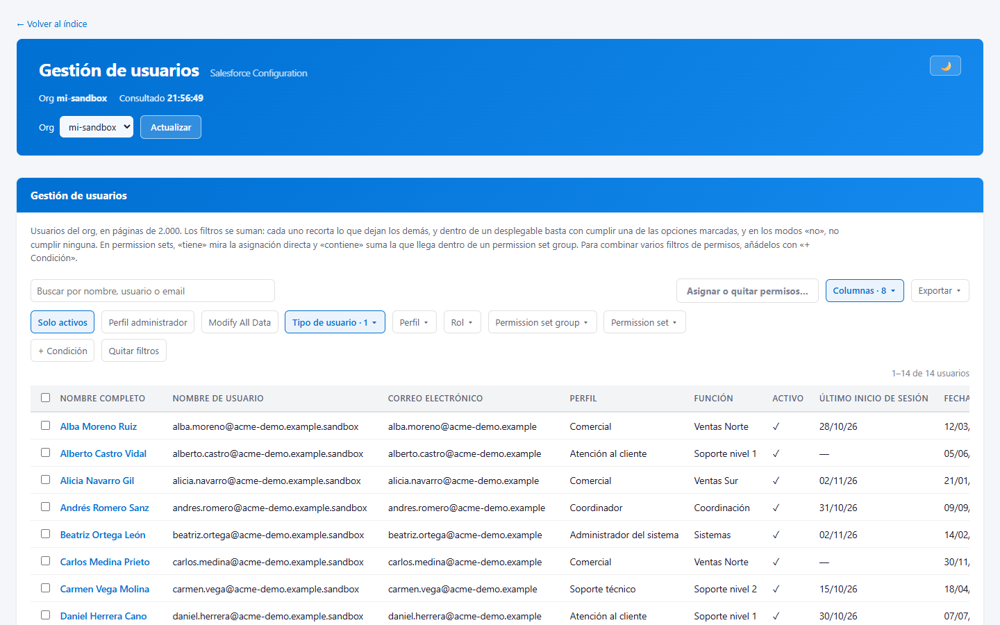
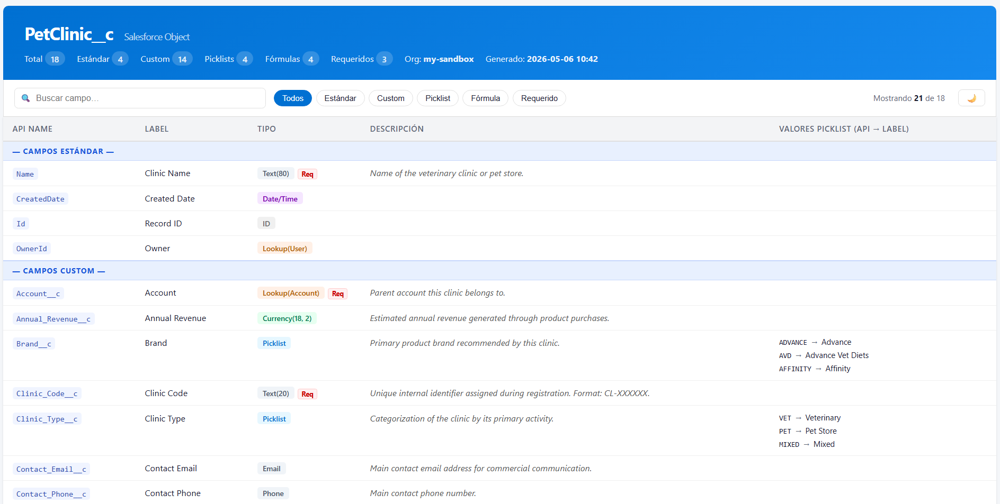
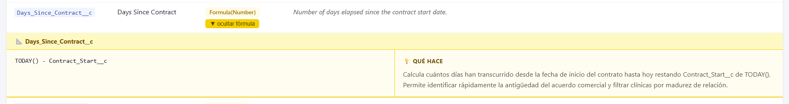
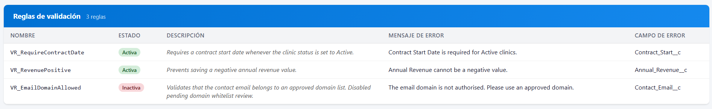
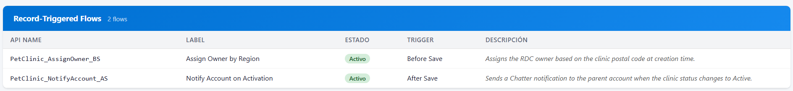
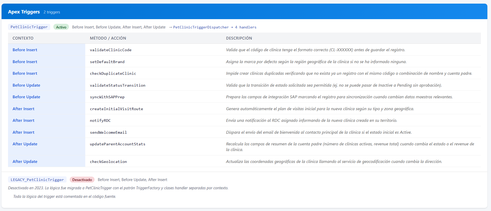
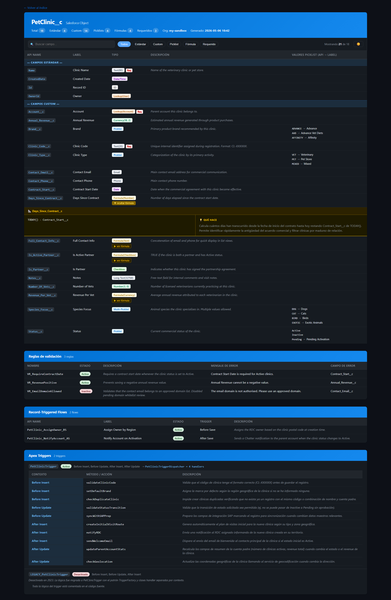

# documentar-objeto

Skill para Claude Code que genera documentación HTML interactiva de cualquier objeto Salesforce —campos, valores picklist, explicaciones de fórmulas, reglas de validación, flows, triggers Apex y observaciones a revisar— y la sirve en local con un botón para actualizarla desde el org que elijas. El mismo servidor abre tres páginas que consultan el org en vivo: gestión de usuarios, licencias y flows.

## Características

### Páginas de objeto

- **Catálogo completo de campos** — estándar y custom, con badges de tipo, marcadores de campo requerido y valores picklist (`valor API → Label`). Los picklists largos hacen scroll dentro de su celda.
- **Explicaciones de fórmulas** — panel expandible por campo fórmula con el código y una explicación generada por IA.
- **Reglas de validación** — nombre, estado, descripción y mensaje de error, con filtro «Solo activas».
- **Record-Triggered Flows** — tipo de trigger, estado, versión y descripción, con filtro «Solo activos». Los flows sin descripción propia reciben una generada por IA a partir de su versión activa, marcada como `IA`.
- **Apex Triggers** — detecta el patrón TriggerFactory y los handlers directos, y lista cada método por contexto, agrupado por operación (insert, update, delete…).
- **Revisar** — observaciones automáticas sobre el objeto (solapamiento de flows y triggers, automatización muerta, fórmulas problemáticas, metadata sin documentar), marcadas como no verificadas.
- **Botón Actualizar con selector de org** — regenera la página desde el org elegido sin tener que pedírselo a Claude (ver «Cómo funciona»).
- **Búsqueda y filtros** — búsqueda en tiempo real por API name o label; filtros por tipo (estándar, custom, picklist, fórmula, requerido).
- **Modo oscuro** — interruptor común a todas las páginas, guardado en `localStorage`.
- **Cachés** — las explicaciones de fórmulas se cachean por fórmula y las descripciones de flows por versión: solo se regenera lo que ha cambiado.
- **Índice** — `index.html` con todos los objetos documentados y enlaces a las páginas en vivo.

### Páginas en vivo (Salesforce Configuration)

Consultan el org en cada carga y no guardan nada en disco, porque muestran datos de usuarios. Tienen un selector de org con los alias autenticados en la CLI, que recuerda el último elegido y marca `PRODUCCIÓN` cuando el org no es un sandbox (lo pregunta al org, no lo deduce del alias).

- **Gestión de usuarios** (`userList`) — listado de usuarios con filtros acumulables y columnas a elegir, exportación, asignar y quitar permission sets y permission set groups (la única escritura en el org, con confirmación), visor de permission set groups y visor de permission sets y perfiles.
- **Licencias** (`userLicence`) — licencias de usuario, de funcionalidad (Service Cloud User, Knowledge User…), de permission set y de paquetes instalados con su uso, y usuarios activos por licencia y por perfil, con los que no entran desde hace 90 días.
- **Flows** (`flows`) — todos los flows del org con filtros, buscador y ordenación.

## Requisitos

| Herramienta | Versión |
|-------------|---------|
| Python | 3.9 + (solo librería estándar: no hay nada que instalar) |
| Salesforce CLI (`sf`) | 2.x |
| Claude Code | con el comando `claude` en el PATH, para el botón Actualizar |

El CLI debe estar autenticado contra los orgs que quieras documentar:

```bash
sf org login web --alias mi-sandbox
```

Las explicaciones de fórmulas, las descripciones de flows, el análisis de triggers y las observaciones las redacta Claude mientras ejecuta la skill: no hace falta API key ni SDK aparte.

## Instalación

Copia la carpeta del skill en el directorio de skills de Claude Code:

```bash
# macOS / Linux
cp -r documentar-objeto ~/.claude/skills/

# Windows (PowerShell)
Copy-Item -Recurse documentar-objeto "$env:USERPROFILE\.claude\skills\"
```

Reinicia Claude Code (o recarga la ventana) para que el skill quede disponible.

## Uso

Desde la raíz de un proyecto Salesforce:

```
/documentar-objeto <NombreApiObjeto> <AliasOrg>     # documenta un objeto
/documentar-objeto all <AliasOrg>                   # regenera todos los ya documentados
/documentar-objeto userList <AliasOrg>              # abre la gestión de usuarios
/documentar-objeto userLicence <AliasOrg>           # abre el panel de licencias
/documentar-objeto flows <AliasOrg>                 # abre el visor de flows
```

Claude arranca el servidor si no está levantado y abre la página en el navegador. También se puede arrancar a mano:

```bash
python <ruta-del-skill>/scripts/servir_documentator.py --org mi-sandbox
```

y abrir `http://127.0.0.1:8788/`. Las páginas de objeto se pueden abrir también desde el disco, pero entonces el botón Actualizar no funciona y las páginas en vivo no cargan.

| Opción | Por defecto | Para qué |
|---|---|---|
| `--org` | el primer alias de la CLI | Org con el que se abre |
| `--puerto` | `8788` | Puerto local |
| `--raiz` | `.` | Carpeta que contiene `documentator/` |
| `--abrir` | el índice | Ruta que abrir, p. ej. `vivo/usuarios` |
| `--sin-abrir` | — | No abrir el navegador |

## Ejemplos

> Abre [`docs/demo.html`](docs/demo.html) en cualquier navegador para probar una página de objeto con el objeto ficticio `PetClinic__c`, sin servidor ni org de Salesforce. Es de una versión anterior: no tiene el botón Actualizar ni los filtros de activos.

### Gestión de usuarios — página en vivo

Con nombres, usuarios, correos, perfiles y org ficticios.



Las capturas de la página de objeto que siguen son de la versión anterior.

### Tabla de campos — búsqueda, filtros y copia de API names



### Campos fórmula — código expandible + explicación IA



### Reglas de validación



### Record-Triggered Flows



### Apex Triggers — métodos por contexto



### Modo oscuro



## Estructura del proyecto

```
documentar-objeto/
├── SKILL.md                        # Instrucciones del skill para Claude Code
├── README.md
├── docs/
│   ├── demo.html                   # Demo autocontenida (objeto ficticio)
│   └── screenshots/                # Imágenes usadas en este README
└── scripts/
    ├── sf_doc_generator.py         # Generador de las páginas de objeto y del índice
    ├── servir_documentator.py      # Servidor local: ficheros, botón Actualizar y páginas en vivo
    ├── org.py                      # Acceso al org: sesión prestada de la CLI y API REST
    ├── secciones/                  # Una sección de página en vivo por módulo
    │   ├── __init__.py             # Qué secciones lleva cada página
    │   ├── usuarios.py, visor_grupos.py, visor_permisos.py
    │   ├── licencias.py
    │   └── visor_flows.py
    └── plantilla/                  # HTML, CSS y JS de las páginas en vivo
```

Tras ejecutar el skill, el proyecto de destino recibe un subdirectorio por objeto:

```
documentator/
├── index.html
├── manifest.json
├── Account/
│   ├── Account.html
│   ├── _formula_cache.json         # Caché persistente de fórmulas (no borrar)
│   └── _flow_cache.json            # Caché persistente de flows (no borrar)
└── ...
```

## Cómo funciona

**Al documentar un objeto**, Claude sigue los pasos de `SKILL.md`:

1. **Fórmulas** — saca las fórmulas del objeto con el generador (`--formulas`) y explica solo las nuevas o modificadas respecto al caché.
2. **Flows** — consulta los record-triggered flows del objeto y describe los que no tienen descripción propia a partir de su versión activa, reutilizando el caché si la versión no ha cambiado.
3. **Triggers** — escanea los ficheros `.trigger` locales, detecta el patrón de delegación (TriggerFactory o handler directo), lee las clases handler y describe sus métodos por contexto.
4. **Revisar** — anota lo que llama la atención del objeto completo.
5. **Generación** — el generador consulta el org (describe, descripciones de campo, reglas de validación y flows), combina todo en un HTML autocontenido, actualiza el índice y borra sus temporales.

**El botón Actualizar** de una página de objeto pide al servidor que repita esos pasos con el org del selector. El servidor lanza Claude Code sin interfaz (`claude -p`) con una lista cerrada de herramientas: leer el repo, escribir solo en `documentator/`, consultar el org en lectura y ejecutar el generador. Lo demás se deniega sin preguntar. Las actualizaciones van de una en una, y la página se recarga sola cuando termina la suya.

**Las páginas en vivo** toman prestada la sesión de la CLI una vez por org y a partir de ahí consultan por la API REST, que es mucho más rápido que lanzar la CLI en cada consulta. No guardan credenciales propias.

## Licencia

MIT
